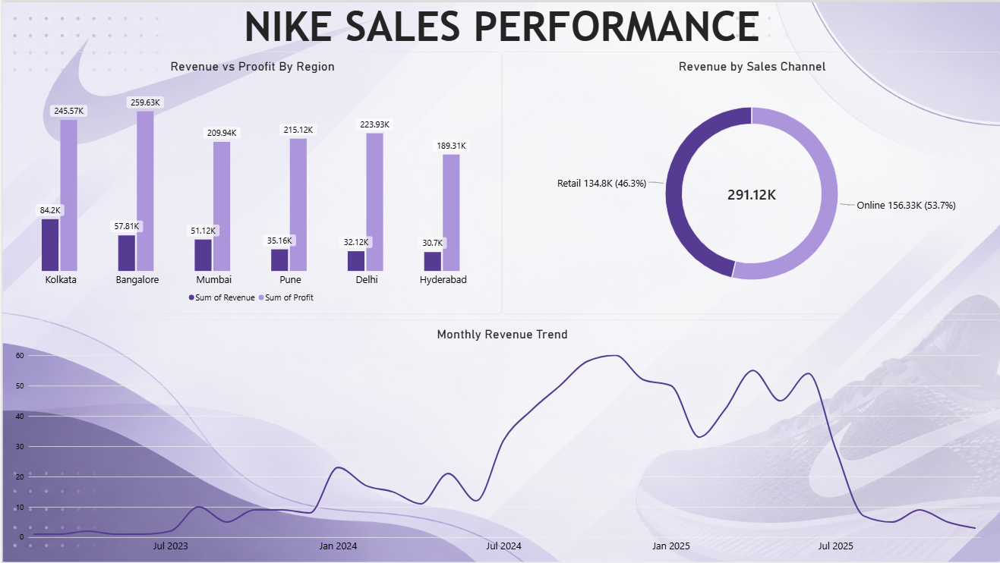
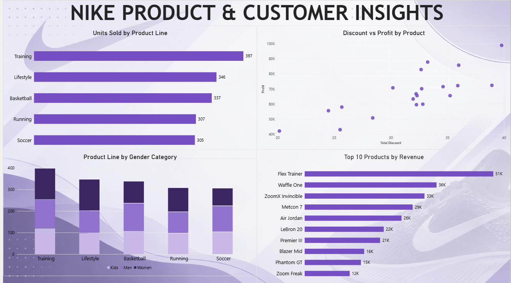

# Nike Sales Analysis | Power BI

An end-to-end data analytics project focused on **data cleaning, data manipulation, exploratory analysis, and interactive dashboarding** using Nike sales data.

The project presents two Power BI dashboards: one for overall sales performance and another for product and customer insights. The aim is to turn raw sales records into useful visual summaries while also identifying data-quality issues that may affect interpretation.

## Dashboards

### 1. Nike Sales Performance



This dashboard explores:
- Revenue and profit by region
- Revenue split between Online and Retail channels
- Monthly revenue trends

### 2. Nike Product & Customer Insights



This dashboard explores:
- Units sold by product line
- Discount versus profit by product
- Product-line performance across gender categories
- Top 10 products by revenue

## Project Objectives

- Clean and prepare sales data for analysis.
- Identify missing values, duplicates, inconsistent entries, and unusual values.
- Manipulate and categorize data for clearer analysis.
- Build clear, interactive Power BI dashboards.
- Identify patterns in regional performance, sales channels, products, and customer segments.
- Highlight data-quality limitations alongside business insights.

## Tools & Skills

- **Power BI** — dashboard design and data visualization
- **Microsoft Excel** — source data review and preparation
- **Data cleaning and transformation**
- **Exploratory data analysis**
- **Business intelligence and insight communication**

## Key Metrics & Findings

Based on the analysed dataset and dashboard report:

| Metric / Finding | Result |
|---|---:|
| Order records analysed | 1,000 |
| Unique Order IDs | 947 |
| Net revenue | ₹291.12K |
| Total profit recorded | ₹1,343.50K |
| Net units sold | 1,692 |
| Revenue share from Online | 53.7% |
| Revenue share from Retail | 46.3% |
| Leading region by revenue | Kolkata — ₹84.2K |
| Leading region by recorded profit | Bangalore — ₹259.6K |
| Leading product line by revenue | Training — ₹115.38K |
| Leading product by revenue | Flex Trainer — ₹51.5K |

### Insights

- **Regional performance:** Kolkata recorded the highest revenue, while Bangalore led in recorded profit and also had the highest order count and unit volume.
- **Sales channels:** Online contributed 53.7% of revenue, compared with 46.3% from Retail.
- **Product lines:** Training led both units sold and revenue, contributing about 40% of net revenue.
- **Product concentration:** The top 10 products generated approximately 90% of net revenue.
- **Monthly trend:** Revenue increased through parts of 2024, peaked in December 2024, and fell during the second half of 2025. Missing dates and incomplete records may affect this trend.

## Data Quality Checks

The analysis identified issues that are important when interpreting the dashboard:

- 221 records had no order date.
- 53 Order IDs were repeated across records.
- 932 of the 1,000 rows had zero revenue; 20 had negative revenue.
- 92 rows had negative units sold, which may represent returns or reversals.
- 76 records had discounts above 100%.
- Some fields contained placeholder-like or inconsistent values.

These issues may influence reported revenue trends and product-level results. In particular, **recorded profit is substantially higher than net revenue**, so these measures should not be treated as directly comparable until the underlying calculations and source data are validated. The dashboards are useful for exploratory analysis, but the findings should be interpreted with these limitations in mind.

## Repository Structure

A suggested structure for publishing the project:

```text
nike-sales-analysis/
├── README.md
├── data/
│   └── Nike_Sales.xlsx
├── dashboard/
│   └── Nike_Sales_Analysis.pbix
└── images/
    ├── nike-sales-performance.png
    └── nike-product-customer-insights.png
